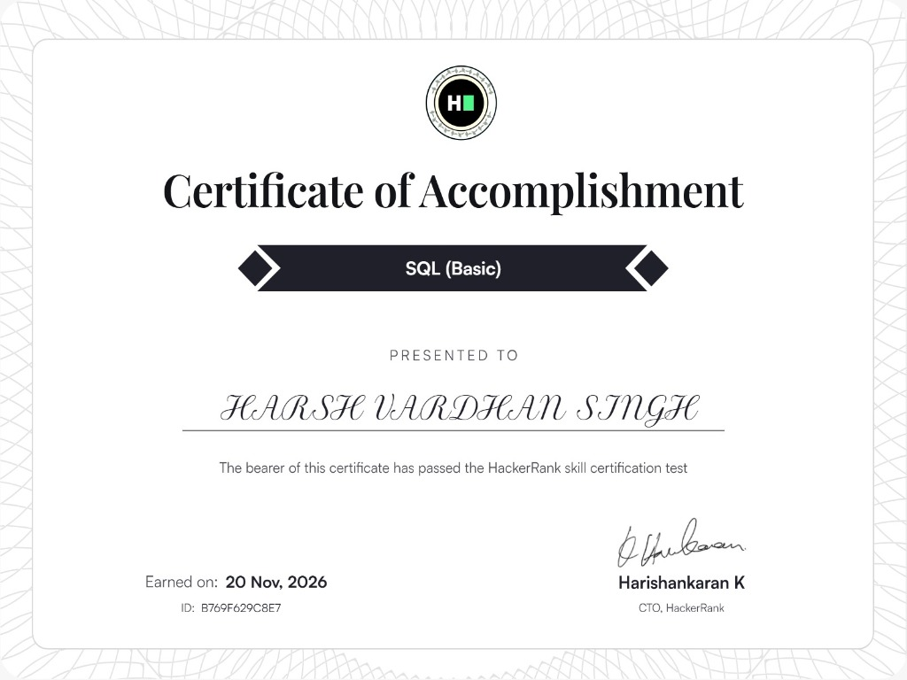
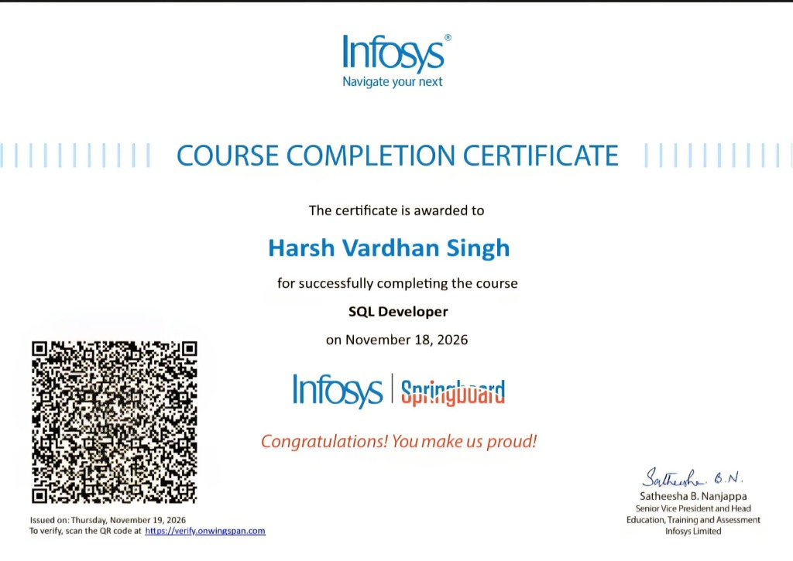

# 🎓 Industry Certifications in SQL & Database Engineering

**Candidate:** Harsh Vardhan Singh  
**Track:** Relational Database Management Systems & SQL Development  

---

## 📜 1. HackerRank - SQL (Basic) Certification

- **Issuing Organization:** HackerRank
- **Credential Name:** SQL (Basic) Skill Certification
- **Recipient:** Harsh Vardhan Singh
- **Earned Date:** 20 November, 2026
- **Certificate ID:** `B769F629C8E7`
- **Signatory:** Harishankaran K (CTO, HackerRank)

---

## 📜 2. Infosys Springboard - SQL Developer Certification

- **Issuing Organization:** Infosys Springboard
- **Credential Name:** SQL Developer Course Completion Certificate
- **Recipient:** Harsh Vardhan Singh
- **Completion Date:** November 18, 2026
- **Issue Date:** November 19, 2026
- **Verification Portal:** [https://verify.onwingspan.com](https://verify.onwingspan.com)
- **Signatory:** Satheesha B. Nanjappa (Senior Vice President & Head - Education, Training & Assessment, Infosys Limited)

